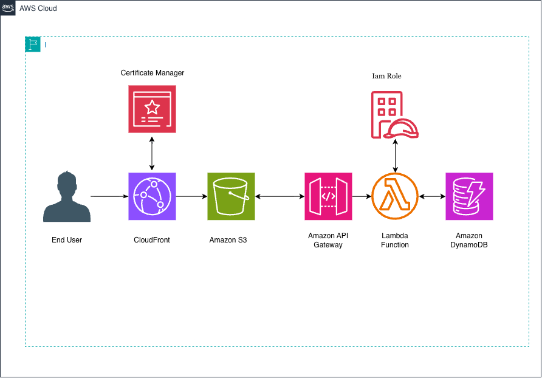

# ☁️ AWS Cloud Resume Challenge

My implementation of Forrest Brazeal's [Cloud Resume Challenge](https://cloudresumechallenge.dev "AWS Cloud Resume Challenge official page"), showcasing hands-on experience building, automating, and deploying a full-stack serverless application on Amazon Web Services.


---

## 🏗️ Architecture Diagram



### How It Works
1. **DNS & Content Delivery:** Users visit the custom domain managed via **Amazon Route 53**, which routes traffic through **Amazon CloudFront** with HTTPS enforced using an SSL/TLS certificate from **AWS Certificate Manager (ACM)**.
2. **Static Frontend:** CloudFront serves the static HTML, CSS, and JavaScript files stored securely in a private **Amazon S3** bucket.
3. **Visitor Counter API:** When the webpage loads, a JavaScript fetch request calls an **Amazon API Gateway** endpoint.
4. **Serverless Backend & Database:** API Gateway triggers an **AWS Lambda** function written in Python (`boto3`), which increments and retrieves the total visitor count stored in **Amazon DynamoDB**.
5. **Infrastructure as Code & CI/CD:** All backend cloud resources are defined using **Terraform / AWS SAM**, and code updates are automatically tested and deployed via **GitHub Actions**.

---

## 🛠️ Tech Stack & AWS Services

* **Frontend:** HTML5, CSS3, JavaScript
* **Storage & CDN:** Amazon S3, Amazon CloudFront
* **Networking & Security:** Amazon Route 53, AWS Certificate Manager (ACM), IAM
* **Backend & Database:** AWS Lambda (Python 3.x), Amazon API Gateway, Amazon DynamoDB
* **Infrastructure as Code (IaC):** Terraform *(or AWS SAM)*
* **CI/CD & Testing:** GitHub Actions, Pytest

---

## 📂 Repository Structure

```text
├── .github/workflows/       # GitHub Actions CI/CD pipelines for frontend and backend
├── frontend/                # HTML, CSS, and JS files for the resume website
├── backend/                 # Python Lambda function code and unit tests
│   ├── lambda_function.py
│   └── test_lambda.py
├── infra/                   # Terraform / AWS SAM configuration files
├── images/                  # Architecture diagram and screenshots
└── README.md                # Project documentation
```

---

## 🚀 CI/CD Pipeline Workflow

* **Frontend Pipeline:** Pushing changes to the `frontend/` directory triggers a GitHub Actions workflow that syncs files to the S3 bucket and invalidates the CloudFront cache so updates appear immediately.
* **Backend Pipeline:** Pushing changes to `backend/` or `infra/` runs Python unit tests (`pytest`), packages the Lambda function, and applies infrastructure changes automatically.

---

## 🧠 Key Takeaways & Challenges Solved

* **CORS Configuration:** Configured Cross-Origin Resource Sharing on API Gateway so the frontend domain could securely communicate with the backend API.
* **Least Privilege Security:** Restricted S3 bucket access exclusively to CloudFront via Origin Access Control (OAC) and scoped IAM roles strictly to required DynamoDB actions.
* **Automated Testing:** Added unit tests using `moto` / `pytest` to verify Lambda database logic before deploying changes to production.

---


